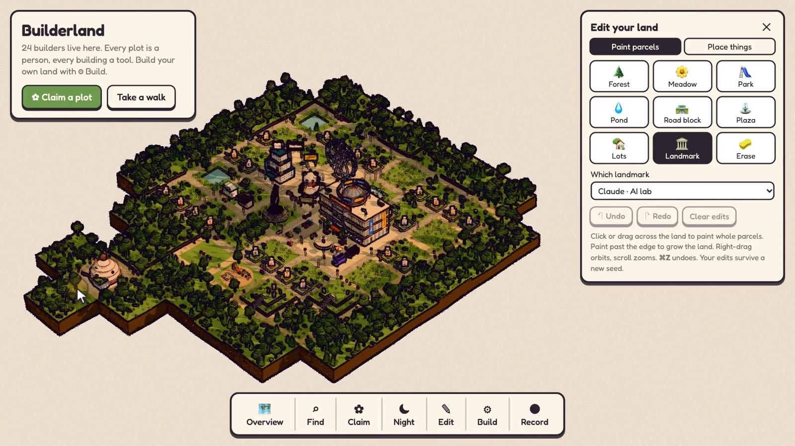
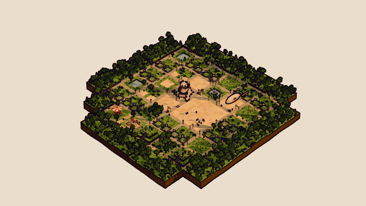
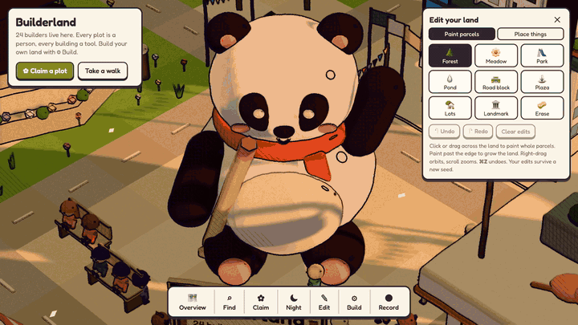
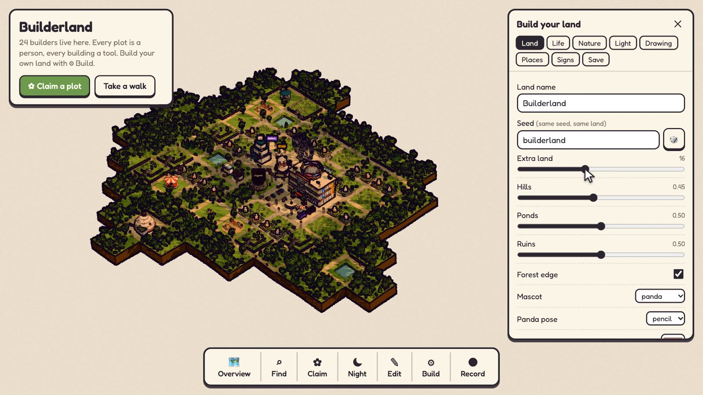
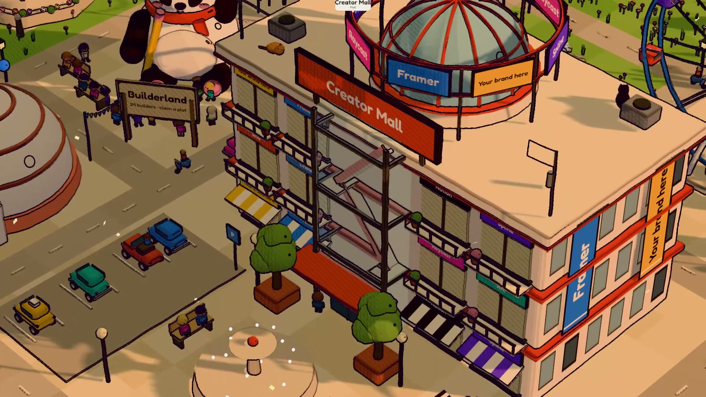
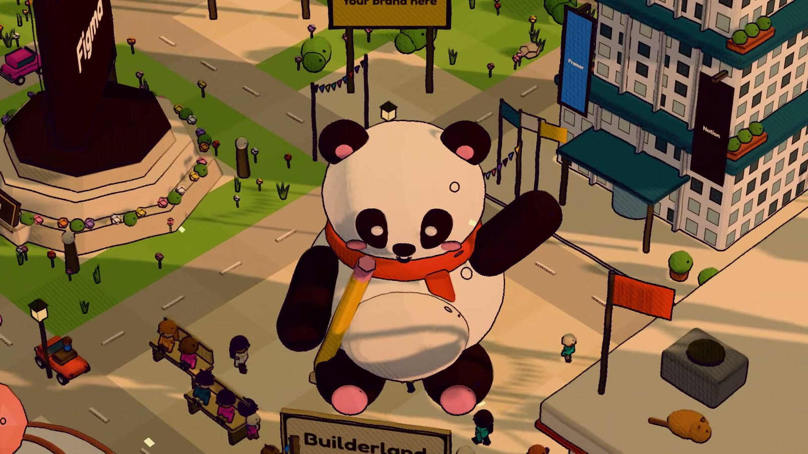
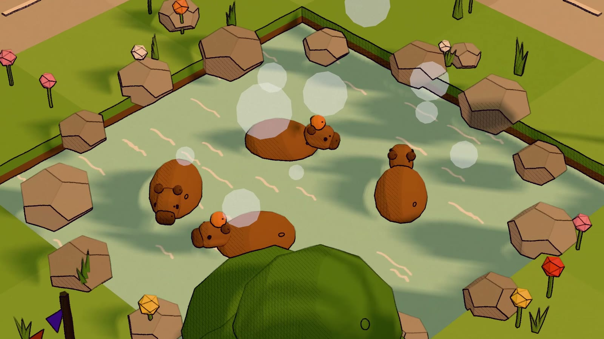
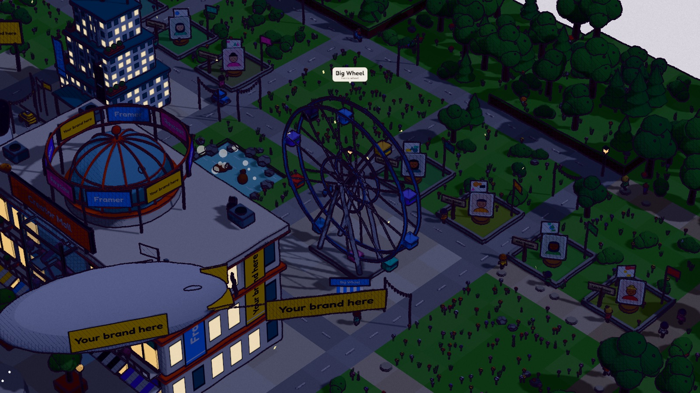
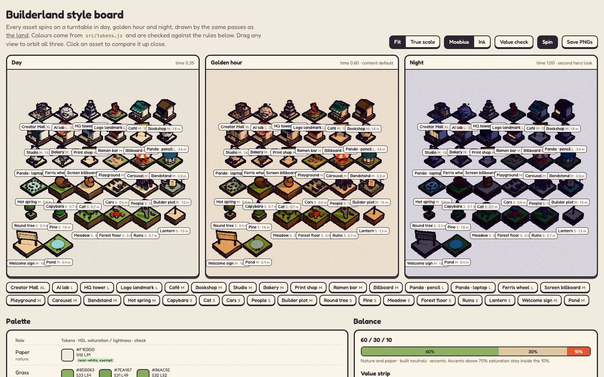

# Builderland

[](https://x.com/noormtir)
[](https://donate.stripe.com/9B68wPcAl5vQdtOgqmfrW0g)
[](LICENSE)

**A hand-drawn, procedural land for builders.** Every builder gets a garden plot, every tool they love gets a building, and sponsors get the billboards. It's generated from a seed, you can paint and edit every parcel, and it runs in the browser with no build step.

**[Open the live land →](https://builderland.noormtir.com)** · [Style board](https://builderland.noormtir.com/style)

[](docs/media/demo.mp4)

<p align="center"><a href="docs/media/demo.mp4">▶ Watch the demo (23 s)</a></p>



## Build it your way

Open **Edit** and paint the land parcel by parcel: forest, meadow, park, pond, road, plaza, lots, or a landmark. Paint past the edge and the land grows there. Erase leaves a hole. Every edit is saved with the land and survives a new seed.



**Build** gives you about 40 live knobs: land size, hills, ponds, season, trees, people, cars, time of day, line weight, hand wobble, paper grain… Change the seed and you get a different land with the same buildings.



## What's in it

| | |
|---|---|
|  | **Buildings for tools.** A three-floor Creator Mall with 12 sponsor bays and a rotating billboard ring. An AI lab, an HQ tower, a Ferris wheel, logo landmarks (drop in an SVG and it's extruded into a 3D sculpture) and six shop styles: café, bookshop, studio, bakery, print shop, ramen bar. |
|  | **Plots for builders.** Each one has a paper standee of their avatar, their work on an easel, a signpost, a flag and their links, plus a little walking version of them. A giant panda waves from the plaza (three poses, a scarf in your colour). |
|  | **Something alive in every frame.** Cars that keep their lane and slow at junctions. People who walk, sit, queue and cheer. Kids on the slide and swings. Capybaras in a hot spring, cats on the roofs, a blimp overhead. |
|  | **Day to night.** Golden hour by default. At night the windows, lamps and the Ferris wheel light up. |

**One Signs list rebrands everything.** The mall bays, banners, bunting, food trucks, the screen billboard, the gondolas and the blimp all read from it. The first sign gets the blimp.

**Share it.** Record a 20 s film or a frame-perfect MP4 (rendered frame by frame, so nothing drops) in 16:9, 1:1, 4:5 or 9:16. Save a share card, a PNG, the whole land as `.glb`, or the land as JSON.

## Run it

```bash
git clone <this repo> && cd builderland
npx serve .            # or: python3 -m http.server
```

Plain ES modules, with Three.js and GSAP from a CDN. Nothing to install or build.

| Key | |
|---|---|
| `E` | edit (paint parcels, place things) |
| `B` | build panel |
| `H` | hide the interface, for screen recording |
| `Esc` | back to the overview |
| `R` / `⌫` / `⌘Z` | in the editor: rotate, remove, undo |

Add `?embed` to the URL to hide the interface (for iframes), and `#r=<id>` to open on a builder or a place.

## Make it yours

Everything saves in your browser. **Build → Save** exports the land as JSON, which is the whole land:

```js
{
  title: 'Builderland',
  seed: 'builderland',
  params: { size: 6, season: 'autumn', time: 0.6 },   // any knob from src/params.js
  places: [{ kind: 'lab', name: 'My lab', color: '#7B61FF', url: 'https://…' }],
  signs: [{ name: 'Your brand', color: '#F2B705' }],
  map: { '3,-2': 'park', '-1,5': 'place:place-0-my-lab' },  // hand-painted parcels
  props: [{ type: 'bench', x: 4.5, z: 2.0, rot: 0 }],        // hand-placed things
}
```

Place kinds: `lab`, `logo`, `hq`, `mall`, `wheel`, `shop`, `billboard`, `screen`.

The builders you see on first load are made-up sample residents. Turn them off in **Build → Save**. Real plots come from **Claim a plot** and are saved in your browser for now.

## Logos

The repo ships names only, no third-party logos. To show a real one, upload the brand's official file in **Build → Places** or **Build → Signs**, and keep it unaltered.

## The style board

[`style.html`](style.html) puts every asset on a turntable in day, golden hour and night, side by side, and checks the palette in [`src/tokens.js`](src/tokens.js) against its saturation and value rules. **Value check** turns everything grey. Use it to check a new building before it goes into the land.



## How it's built

| File | |
|---|---|
| `src/world.js` | layout, terrain, roads, flora, camera, film |
| `src/tokens.js` | palette, light presets, colour rules |
| `src/places.js` `src/mall.js` `src/park.js` `src/signs.js` | buildings, parks, animals, sponsor surfaces |
| `src/traffic.js` `src/folk.js` | cars on a lane graph, chibi people |
| `src/editor.js` `src/main.js` | the editor and the panels |
| `src/merge.js` | merges still parts so the whole land stays around 900 draw calls |
| `src/engine/` | renderer, the hand-drawn (Moebius) and ink outline passes, labels, export |

The hand-drawn look is a post-processing pass after [Maxime Heckel's Moebius breakdown](https://blog.maximeheckel.com/posts/moebius-style-post-processing/): outlines from depth and normals, wobble, and crosshatching in the shadows.

To add a building, a car or a prop, see [`docs/asset-guide.md`](docs/asset-guide.md) and [`CONTRIBUTING.md`](CONTRIBUTING.md).

## Deploy

`npm run deploy` builds `./dist` and ships it to Cloudflare Workers with Wrangler. Put your own domain in `wrangler.jsonc`, or remove `routes` to use a free `*.workers.dev` address. Any static host works too: just upload `index.html`, `style.html` and `src/`.

## Support

I build things like this in public. Follow along on X: [@noormtir](https://x.com/noormtir).

If Builderland made you smile, you can [buy me a coffee ☕](https://donate.stripe.com/9B68wPcAl5vQdtOgqmfrW0g).

## License

[MIT](LICENSE) © Noor Mtir
